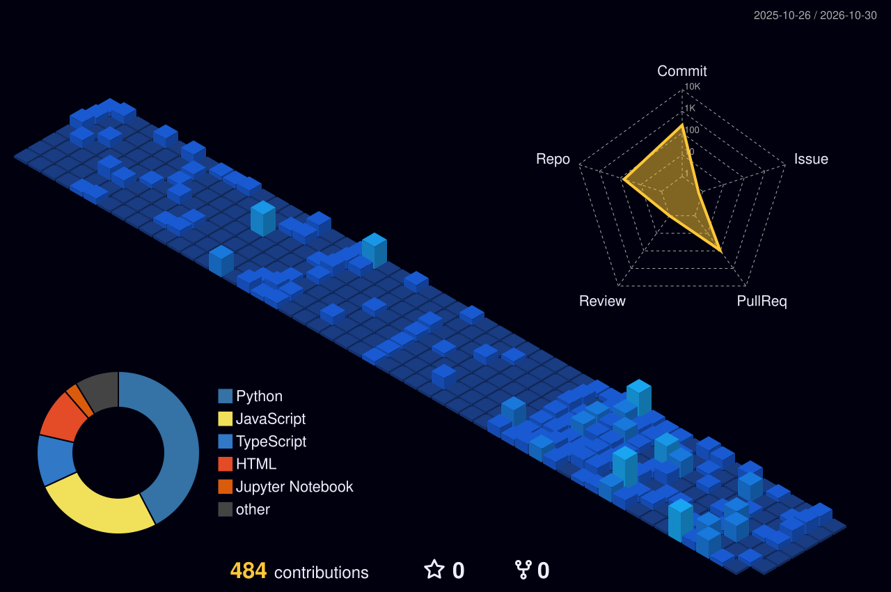

<div align="center">


[](https://www.linkedin.com/in/noor-mudasir-299a64256/)
[](https://github.com/Noor-ul-ain001)
[](https://noor-portfolio-steel.vercel.app)
[](mailto:aina25239@gmail.com)


</div>

## 👋 About Me

I am **Noor ul Ain**, an Agentic AI Engineer from **Karachi, Pakistan** (BA, University of Karachi) with a deep passion for building production-grade systems that bridge the gap between cutting-edge AI research and real-world applications. My expertise lies in designing **multi-agent orchestrations**, developing robust **RAG pipelines**, and integrating **MCP workflows** — all the way from initial architecture to seamless deployment.

My mission is to create autonomous, intelligent systems that act as digital employees (FTEs), solving complex problems with loop engineering and spec-driven development. I take pride in my ability to ship high-quality code, evidenced by my **12 merged open-source contributions**, and my relentless pursuit of learning through programs like the **Panaversity Agent Factory**.

| | |
|---|---|
| ⚡ | **12 Merged PRs** across active open‑source repos (github/spec‑kit, OpenClaw) |
| 🤖 | Currently enrolled in **Panaversity Agent Factory Program (GIAIC)** under Sir Anas — specializing in Loop Engineering & Digital FTE |
| 🏗️ | Proficient in multi-agent orchestration, harness engineering, and spec‑driven development |
| 🎓 | **Anthropic Certified** — MCP Fundamentals, Claude Code in Action, Claude 101 |
| 🗄️ | Sole database architect on **HungerMap PK** — a standout project from the DYLP GenAI Hackathon 2026 |
| 🌐 | Check out my work live at [noor-portfolio-steel.vercel.app](https://noor-portfolio-steel.vercel.app) |

### 🛤️ My Journey

```text
🏫 Panaversity Agent Factory (GIAIC) ───────────────── 2024 → present
   Agentic AI, Loop Engineering, Digital FTE & Spec-Driven Development.

🌟 Open-Source Contributor ─────────────────────────── 2024 → present
   11 merged PRs to github/spec-kit and 1 to OpenClaw.

🗺️ DYLP GenAI Hackathon 2026 ───────────────────────── 2026
   Architected the entire HungerMap PK database (Neon DB + Drizzle ORM).

🎓 BA — University of Karachi ──────────────────────── Completed
   Plus certifications from Anthropic, Panaversity and more.
```

<div align="center">


</div>

## 🌟 Open‑Source Contributions

#### 🐙 [github/spec-kit](https://github.com/github/spec-kit) — GitHub's spec‑driven developer tooling


- ✅ Fixed `CURRENT_BRANCH` fallback logic in Git extension scripts to prevent runtime errors.
- ✅ Added support for multi‑expression template interpolation, making the tool more flexible.
- ✅ Implemented host‑less catalog URL validators to improve security and reliability.
- ✅ Documented previously undocumented subcommands, enhancing the developer experience.
- ✅ Improved overall CLI reliability and edge‑case handling across multiple PRs.

#### 🦾 [OpenClaw](https://github.com/openclaw/openclaw) — AI coding agent CLI


- ✅ Fixed a false‑positive "cron service unavailable" warning for healthy scheduled jobs (Issue #69939).

## 🚀 Featured Projects

| 🔖 | Project | Stack | Description |
|---|---|---|---|
| 🤖 | **AI Employee (Digital FTE)** | Python · OpenAI SDK · MCP | An autonomous AI employee that executes complex tasks using harness files, loop engineering, and human‑in‑the‑loop feedback. |
| 🔍 | **Multi‑Agent Codebase Auditor** | Python · FastAPI · Pydantic AI · Claude API | A 4‑agent pipeline (Mapper, Security Auditor, Skill Generator, Prioritizer) that audits and improves codebases. |
| 🗺️ | **HungerMap PK** | Next.js · Neon DB · Drizzle ORM · FastAPI | Tackles food insecurity by matching NGOs with resources. Sole database architect — DYLP GenAI Hackathon 2026. |
| 💬 | **RAG‑Based AI Chatbot** | Python · FastAPI · Vector DB | A retrieval-augmented chatbot using semantic search for accurate, context-aware answers. |
| 🎮 | **AI Fluency Arcade** | HTML · CSS · Vanilla JS | An interactive web app teaching 13 core AI prompting concepts — a Panaversity challenge submission. |
| 🌐 | **Personal Portfolio** | Next.js · TypeScript · Framer Motion | A dark, cinematic noir-themed portfolio deployed on Vercel. |
| 👁️ | **Background Removal Tool** | Python · OpenCV · MediaPipe | Real-time background removal powered by pose estimation. |

## 🏙️ My Contributions, as a City

<div align="center">



</div>

## 🏅 Certifications

| 🎓 Issuer | 📜 Certification |
|---|---|
| 🧠 **Anthropic** | MCP Fundamentals · Claude Code in Action · Claude 101 |
| 🏫 **Panaversity (GIAIC)** | Agent Factory Program · Agentic AI Architecture |
| 📊 **Vista Equity Partners** | Forage Job Simulation |
| ✈️ **Skyscanner** | Forage Job Simulation |
| 📚 **Freeacademy** | Additional technical certifications |

<div align="center">


*🤝 Open to remote internships and roles in AI/ML Engineering, Agentic AI, and Full‑Stack Development. Let's build something amazing together!*

[](mailto:aina25239@gmail.com)
[](https://www.linkedin.com/in/noor-mudasir-299a64256/)
[](https://noor-portfolio-steel.vercel.app)

</div>
