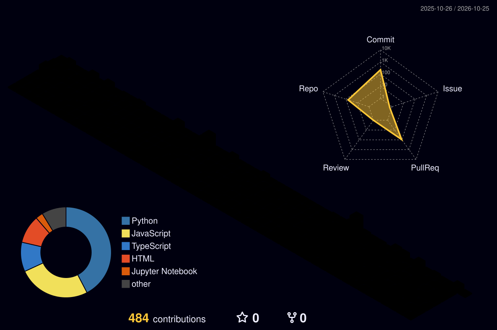

## 👋 About Me

I am **Noor ul Ain**, an Agentic AI Engineer from **Karachi, Pakistan** (BA, University of Karachi) with a deep passion for building production-grade systems that bridge the gap between cutting-edge AI research and real-world applications. My expertise lies in designing **multi-agent orchestrations**, developing robust **RAG pipelines**, and integrating **MCP workflows** — all the way from initial architecture to seamless deployment.

My mission is to create autonomous, intelligent systems that act as digital employees (FTEs), solving complex problems with loop engineering and spec-driven development. I take pride in shipping high-quality code — **<!--S:speckit-->73<!--/S--> merged PRs into [github/spec-kit](https://github.com/github/spec-kit)** and counting — and in my relentless pursuit of learning through programs like the **Panaversity Agent Factory**.

| | |
|---|---|
| ⚡ | **<!--S:merged-->74<!--/S--> merged PRs** in open source, **<!--S:open-->2<!--/S--> more in review** (auto-synced <!--S:synced-->2026-10-20<!--/S-->) |
| 🤖 | Currently enrolled in **Panaversity Agent Factory Program (GIAIC)** under Sir Anas — specializing in Loop Engineering & Digital FTE |
| 🏗️ | Proficient in multi-agent orchestration, harness engineering, and spec‑driven development |
| 🎓 | **Anthropic Certified** — MCP Fundamentals, Claude Code in Action, Claude 101 |
| 🗄️ | Sole database architect on **HungerMap PK** — a standout project from the DYLP GenAI Hackathon 2026 |
| 🌐 | Check out my work live at [noor-ul-ain-dev.vercel.app](https://noor-ul-ain-dev.vercel.app) |

## 🌟 Open‑Source, Live

#### Latest merges · updated automatically every 6 hours

<!-- LATEST:START -->
- ✅ `2026-09-22` [github/spec-kit#4572](https://github.com/github/spec-kit/pull/4572) — fix(workflows): stop list-literal-then-index expressions silently corrupting
- ✅ `2026-09-22` [github/spec-kit#4570](https://github.com/github/spec-kit/pull/4570) — fix(integrations): stop frontmatter injection gluing onto a missing trailing newline
- ✅ `2026-09-21` [github/spec-kit#4325](https://github.com/github/spec-kit/pull/4325) — fix(workflows): reject a non-integer or out-of-range current_step_index in RunState resume
- ✅ `2026-09-21` [github/spec-kit#4323](https://github.com/github/spec-kit/pull/4323) — fix(extensions): ignore non-mapping extension.yml config section
- ✅ `2026-09-10` [github/spec-kit#4337](https://github.com/github/spec-kit/pull/4337) — fix(events): cap stdin in the generated dispatcher, not just the CLI command
- ✅ `2026-09-08` [github/spec-kit#4321](https://github.com/github/spec-kit/pull/4321) — fix(workflows): reject falsy non-mapping step.yml in step add
<!-- LATEST:END -->

#### 🐙 [github/spec-kit](https://github.com/github/spec-kit) — GitHub's spec‑driven development toolkit

- ✅ Hardened workflow steps (fan-in/fan-out, gates, switch, loops) to fail loudly instead of crashing on malformed input.
- ✅ Fixed `CURRENT_BRANCH` fallback logic and multi‑expression template interpolation.
- ✅ Added host‑less / port validation for catalog URLs, and escaped Rich markup in untrusted CLI output.
- ✅ Documented the integration `search` / `info` / `scaffold` subcommands.

#### 🦾 [OpenClaw](https://github.com/openclaw/openclaw) — AI coding agent CLI

- 🔧 Fixed a false‑positive "cron service unavailable" warning on startup (Issue #69939), plus compound model-ID resolution.

## 🚀 Featured Projects

#### 🔗 Visit them live · uptime checked automatically every 6 hours

<!-- PROJECTS:START -->
| | Project | What it is | Live link |
|---|---|---|---|
| 🟢 live | **Shieldly** | Turns online abuse into a case you can file — manipulation checks, tamper-evident evidence and NCCIA complaint drafts, in English & Roman Urdu. | [shieldly-tau.vercel.app](https://shieldly-tau.vercel.app) |
| 🟢 live | **KSoR** | An SDK for governed, authoritative knowledge systems for humans and AI agents — it solves the authority problem, not just search. | [ksor-blush.vercel.app](https://ksor-blush.vercel.app) |
| 🟢 live | **TaskFlow** | The project-management platform designed for the Agent Era — AI-powered task intelligence, built across a multi-phase hackathon. | [hackathon-todo-phase-3.vercel.app](https://hackathon-todo-phase-3.vercel.app) |
| 🟢 live | **IRIS AXIS** | Professional remote CCTV monitoring for U.S. homes and businesses — trained human attention and timely incident reporting. | [iris-axis.vercel.app](https://iris-axis.vercel.app) |
| 🟢 live | **Pixel's AI Academy** | Learn AI by helping Pixel at his help booth — retrieval modes, supervised vs unsupervised and reinforcement learning, one level each. | [summer-camp-game.vercel.app](https://summer-camp-game.vercel.app) |
| 🟢 live | **MCP Transports** | A complete visual breakdown of how MCP clients and servers talk — the transports that carry JSON-RPC between them. | [mcp-2.vercel.app](https://mcp-2.vercel.app) |
| 🟢 live | **JS Visualizer** | Step through JavaScript line by line and watch the call stack and memory change as your code runs. | [js-visualizer-theta.vercel.app](https://js-visualizer-theta.vercel.app) |
| 🟢 live | **The Buzz Crew** | Full-service digital agency from Karachi — social, SEO, web & software, UI/UX and Meta ads for brands in PK, UAE and UK. | [thebuzzcrew.vercel.app](https://thebuzzcrew.vercel.app) |
| 🟢 live | **Portfolio** | Next.js · motion | [noor-ul-ain-dev.vercel.app](https://noor-ul-ain-dev.vercel.app) |
| 🟢 live | **Aesthetoderm** | Client · clinic | [aesthetoderm-website.vercel.app](https://aesthetoderm-website.vercel.app) |
| 🟢 live | **Refine Aesthetics** | Client · clinic | [refine-aesthetics-website.vercel.app](https://refine-aesthetics-website.vercel.app) |
| 🟢 live | **Aurelia Parfum** | React · gsap | [aurelia-parfum.vercel.app](https://aurelia-parfum.vercel.app) |
| 🟢 live | **Palmo Coconut** | Three.js · gsap | [palmo-coconut.vercel.app](https://palmo-coconut.vercel.app) |
| 🟢 live | **DriveHouse Motors** | React | [velox-motors-app-pied.vercel.app](https://velox-motors-app-pied.vercel.app) |
| 🟢 live | **Smash Burger** | Gsap scroll | [smash-burger-landing.vercel.app](https://smash-burger-landing.vercel.app) |
| 🟢 live | **Scroll Chapters** | Next.js · lenis | [scroll-video-chapters.vercel.app](https://scroll-video-chapters.vercel.app) |
| 🟢 live | **Nooritoo Shop** | E-commerce | [noorito-ecom.vercel.app](https://noorito-ecom.vercel.app) |
| 🟢 live | **iPhone Website** | Product landing | [iphone-website-sepia.vercel.app](https://iphone-website-sepia.vercel.app) |
<!-- PROJECTS:END -->

<b>🧠 More agentic builds (source &amp; hackathons)</b>

| 🔖 | Project | Stack | Description |
|---|---|---|---|
| 🤖 | **AI Employee (Digital FTE)** | Python · OpenAI SDK · MCP | An autonomous AI employee that executes complex tasks using harness files, loop engineering, and human‑in‑the‑loop feedback. |
| 🔍 | **Multi‑Agent Codebase Auditor** | Python · FastAPI · Pydantic AI · Claude API | A 4‑agent pipeline (Mapper, Security Auditor, Skill Generator, Prioritizer) that audits and improves codebases. |
| 🗺️ | **HungerMap PK** | Next.js · Neon DB · Drizzle ORM · FastAPI | Tackles food insecurity by matching NGOs with resources. Sole database architect — DYLP GenAI Hackathon 2026. |
| 💬 | **RAG‑Based AI Chatbot** | Python · FastAPI · Vector DB | A retrieval-augmented chatbot using semantic search for accurate, context-aware answers. |
| 🎮 | **AI Fluency Arcade** | HTML · CSS · Vanilla JS | An interactive web app teaching 13 core AI prompting concepts — a Panaversity challenge submission. |
| 🌐 | **Personal Portfolio** | Next.js · TypeScript · Framer Motion | A dark, cinematic noir-themed portfolio at [noor-ul-ain-dev.vercel.app](https://noor-ul-ain-dev.vercel.app). |
| 👁️ | **Background Removal Tool** | Python · OpenCV · MediaPipe | Real-time background removal powered by pose estimation. |

## 🏙️ My Contributions, as a City

<b><!--C:contrib-->480<!--/C--></b> contributions · <b><!--C:commits-->228<!--/C--></b> commits in the last year — rebuilt from live GitHub data

  

<picture>
  <source media="(prefers-color-scheme: dark)" srcset="./profile-3d-contrib/profile-night-rainbow.svg"/>
  <source media="(prefers-color-scheme: light)" srcset="./profile-3d-contrib/profile-season-animate.svg"/>
  
</picture>

<picture>
  <source media="(prefers-color-scheme: dark)" srcset="https://raw.githubusercontent.com/Noor-ul-ain001/Noor-ul-ain001/output/github-contribution-grid-snake-dark.svg"/>
  <source media="(prefers-color-scheme: light)" srcset="https://raw.githubusercontent.com/Noor-ul-ain001/Noor-ul-ain001/output/github-contribution-grid-snake.svg"/>
  
</picture>

*🤝 Open to remote internships and roles in AI/ML Engineering, Agentic AI, and Full‑Stack Development. Let's build something amazing together!*

